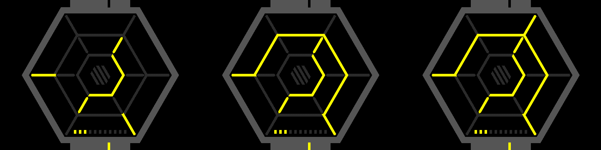
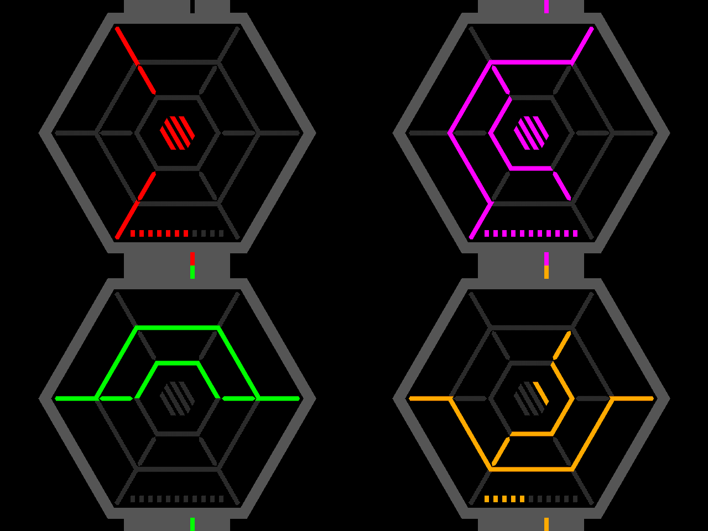
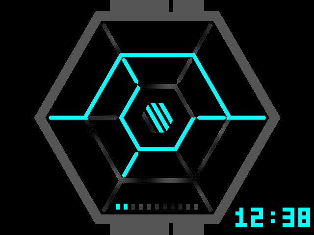

## How it works

Glyph is a clock and calendar on a VGA monitor (640x480 at 60 Hz) that tells
the time the way the Tokyoflash "Glyph" concept watch does: with lit lines on
a web of concentric hexagons instead of hands or digits.

### Reading the face

The hexagon has corners at 3 and 9 o'clock, so the odd hours sit on its six
corners and the even hours on its six flat sides. There are two rings:

- the **outer ring** (outer spokes and the large hexagon) shows the **hour**;
- the **inner ring** (inner spokes and the small hexagon) shows the
  **minutes in steps of five**, with 00 at the top, 05 where the 1 is, and so on;
- the four **stripes in the centre** add 1 to 4 single minutes.

The lit lines copy the edges of the watch nearest the number:

- a number on a **flat side** lights a bracket of three hexagon edges bulging
  toward it, ending in the two spokes three hours either side
  (12 lights the edges at 10, 12 and 2 and the spokes at 9 and 3);
- a number on a **corner** lights the two spokes four hours either side of it,
  which are parallel to the two edges that meet at that corner
  (1 lights the spokes at 9 and 5; 3 lights 11 and 7).

The mode pins make the corner numbers easier:

| Mode | A number on a corner shows |
|---|---|
| Hard | the two spokes only |
| Medium | the two spokes joined round the hexagon, through the corner |
| Easy | the same, plus the spoke at the corner itself, pointing at the number |

The strap carries two bars: the **top bar is lit from noon to midnight** (PM),
and the **bottom bar blinks** once a second.

With **both mode pins high** the face is in easy mode and the time is also
written in digits in the lower right corner (12 hour, in a 3x5 font), for
checking your reading. In the date view the digits are the date, month first:
`7/23` is 23 July.

A row of eleven **ticks at the bottom of the face**, between the 5 and 7
o'clock spokes, counts the seconds in fives: the first lights at 5 seconds,
the second at 10, and so on to 55; all go out when the minute turns.

With **Show date** high the same face shows the date: the outer ring is the
month (1 to 12) and the inner ring and stripes are the day, read like minutes
(the 23rd is the "20" position and three stripes). After reset, and whenever
the view changes, the face draws itself on line by line.

### Inside

Every pixel is classified from three signed distances to the screen centre
(vertical, and the two axes 60 degrees either side), each of which is both
the distance to a pair of hexagon edges and the perpendicular distance to a
pair of spokes. The largest of the three is the pixel's hexagonal radius;
rings are bands of that radius and spokes are bands around zero of the
others, so no multiplier and no line drawing are needed, and the fraction of
a pixel left at a band's edge anti-aliases the lines with the four levels the
2 bit DAC has. The time is stored the way it is shown (hours 0 to 11 and
AM/PM, minutes as fives and ones), so the display needs no division.

The seconds are counted from the pixel clock: 25.175 MHz gives exact
seconds; at 25.000 MHz the clock loses 0.7 percent. February always has 28
days.

### Chip art

Calvin is drawn in Metal4 in the top left of the tile, between the first two
pairs of power stripes (30.0 x 36.5 um, 0.5 um pixels). The ten rows of
standard cells under him are cut out and the router is kept off the patch on
every layer, so there is nothing beneath the picture.

## How to test

Connect a Tiny VGA PMOD to the output port and a 25.175 MHz clock. After
reset the face draws on and shows 12:00 AM, 1 January.

| Pin | Function |
|---|---|
| `ui[0]` | Button A: Hour + in the time view, Month + in the date view; Colour + while `ui[2]` is high |
| `ui[1]` | Button B: Minute + in the time view (also zeroes the seconds), Day + in the date view |
| `ui[2]` | Button A steps the LED colour instead of the hour or month |
| `ui[3]` | Grid on: high draws the unlit segments dimly; low shows only the lit ones and the watch body |
| `ui[4]` | Show the date instead of the time |
| `ui[6:5]` | Mode: 00 hard, 01 medium, 10 easy, 11 easy with the time (or date) in digits |
| `ui[7]` | Fast: the clock runs 900 times faster, a minute every 4 frames |

The two buttons set whatever is on screen. A press advances its field by
one; holding a button repeats after half a second. Setting a field never
carries into the next one. **Both buttons together** put what is on screen
back to its reset value: 12:00:00 AM in the time view, 1 January in the date
view. Nothing else changes, so a host can set any time or date by clearing
and then counting presses. The inputs are sampled once per frame, which
debounces them.

The LED colour steps through yellow (after reset), red, green, blue, magenta,
cyan, amber and white.

## External hardware

[Tiny VGA PMOD](https://github.com/mole99/tiny-vga) on the output port, and a
VGA monitor.
